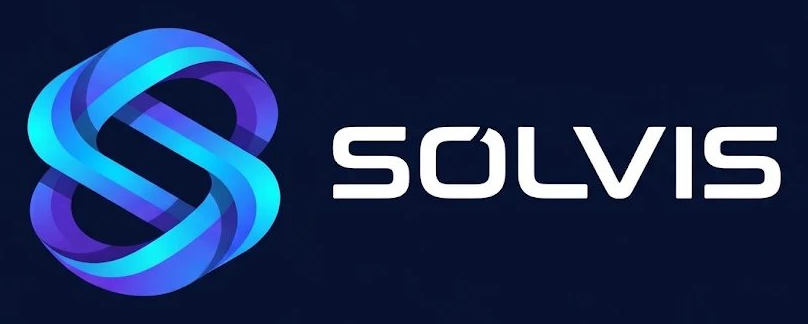

<p align="center">
  
</p>

# SOLVIS - Enterprise Hospital Operations & Asset Intelligence Platform

**SOLVIS** is an enterprise-grade, intranet-optimized Hospital Operations, Asset Inventory, and Service Helpdesk Platform built with **ASP.NET Core 10.0 MVC** and **Entity Framework Core**. Designed for healthcare institutions, enterprise medical centers, and corporate facilities requiring rigorous asset custody auditing, scheduled preventive maintenance, spare parts reserve tracking, and intelligent ticketing workflows integrated with Windows Domain Single Sign-On (SSO).

---

## 🌟 Key Capabilities & Architecture

### 1. 📦 Hospital Asset & Equipment Intelligence
- **Comprehensive Hardware Tracking:** Track asset tags (Hospital No), serial numbers, manufacturers, models, equipment categories, purchase costs, and warranty lifecycles.
- **Warranty & Calibration Monitoring:** Real-time calibration status tracking, certificate logging, and 30-day proactive expiry alerts.
- **Custody Audit Trail:** Automatic historical logging in `asset_history` whenever equipment changes room, floor, or assigned employee.
- **Decommission & Lifecycle Governance:** Controlled retirement flows with audit logs and deletion safety guards.
- **High-Definition Thermal Label Printing:** One-click customizable asset tags with QR code payloads, compact barcodes, and department metadata.

### 2. 🎫 Helpdesk & Engineering Service Ticketing
- **Multi-Team Routing:** Targeted queues for Clinical Engineering, IT Support, HVAC/Facilities, and General Maintenance.
- **Priority Matrix:** Low, Medium, High, and Urgent (fire-priority) queues with pulsing visual indicators.
- **Interactive Discussion Timeline:** Threaded comments, diagnostic updates, image attachments, and technician status changes.
- **Printable Field Work Orders:** Formatted technician service sheets with diagnostic details and physical signature blocks.
- **Export & Compliance:** Filtered CSV exports for audit reviews and SLA reporting.

### 3. 🛠️ Scheduled & Preventive Maintenance
- **Inspection Cycles:** Configure custom inspection frequencies (e.g., 90-day, 180-day, or annual biomedical checks).
- **Overdue Inspection Detection:** Instant dashboard alerts and badge counters for overdue preventive maintenance.
- **Vendor Dispatch & Return Workflow:** Complete custody tracking when equipment is dispatched to external contractors or OEMs for factory servicing.

### 4. ⚙️ Reserve Stock & Spare Parts Inventory
- **Multi-Category Reserves:** Track consumables, periodic maintenance reserves, and spare parts.
- **Dual-Nature Items:** Seamlessly commission high-value reserve components directly into registered independent hospital assets.
- **Usage Auditing:** Link consumed spare parts directly to service tickets with automated inventory decrementing and cost tracking.

### 5. 🔐 Windows Domain SSO & Developer Identity Switching
- **Zero-Password Domain Authentication:** Automatic recognition of Windows workstation credentials (`LOGON_USER` / Windows Negotiate) with fallback security controls.
- **Role-Based Access Control (RBAC):** Strict boundaries separating Administrators, Department Staff, and Specialized Maintenance Teams.
- **Testing Profile Switcher:** Fast testing switcher in the top navigation allowing administrators to simulate any staff persona.

### 6. 🌐 Modern Containerized UI & Dual Language Support
- **Elevated Container Architecture:** Clean, separated page containers with high visual contrast and distinct title hierarchy.
- **Bilingual Interface:** Instant seamless switching between English and Arabic with tailored typography (`Inter` & `Cairo`) and full RTL layout support.
- **Multi-Theme Support:** Light, Clinical Mint, and OLED Dark themes.

---

## 🚀 Getting Started

### Prerequisites
- [.NET 10.0 SDK](https://dotnet.microsoft.com/download)
- Modern web browser (Chrome, Edge, Firefox)

### Run the Application
Clone or navigate to the repository folder and execute:

```bash
# Restore and build the project
dotnet build

# Launch the local web server
dotnet run
```

Open your browser at:
`http://localhost:5174` (or the port specified in your terminal output).

On initial startup, **SOLVIS** automatically initializes the database schema (`SOLVIS_DB` or `solvis.db`) and seeds initial department directories, equipment templates, and administrator profiles.

---

## ⚙️ Database Configuration (`appsettings.json`)

To configure between SQLite and MariaDB/MySQL:

```json
{
  "DatabaseProvider": "Sqlite", // Options: "Sqlite" or "MySql"
  "ConnectionStrings": {
    "SqliteConnection": "Data Source=solvis.db",
    "MySqlConnection": "server=localhost;port=3306;database=SOLVIS_DB;user=root;password=;CharSet=utf8mb4;"
  }
}
```

---

## 📁 Solution Structure

```
stock_and_ticket/
├── Controllers/
│   ├── AccountController.cs       # Profile, identity switching, access rejection
│   ├── AssetsController.cs        # Asset CRUD, custody transfer, QR label printing
│   ├── DirectoryController.cs     # Staff users, rooms, suppliers, departments
│   ├── HomeController.cs          # Executive KPI dashboard, analytics & security compliance
│   ├── MaintenanceController.cs    # Periodic schedules, vendor dispatches, inspection logs
│   ├── SparePartsController.cs     # Reserve stock, spare parts usage, replenishment
│   └── TicketsController.cs       # Service ticketing, technician assignments, work orders
├── Data/
│   ├── StockDbContext.cs          # Entity Framework Core DbContext
│   └── DbInitializer.cs           # Database migration & automatic sample data seeder
├── Middleware/
│   └── DomainAuthMiddleware.cs    # Windows Domain SSO authentication & security guards
├── Models/
│   └── StockModels.cs             # EF Core entities (Asset, Ticket, SparePart, User, etc.)
├── Services/
│   ├── CurrentUserService.cs      # Workstation identity & RBAC resolution
│   ├── LocalizationService.cs     # Bilingual Arabic & English translations
│   └── NotificationService.cs     # Real-time event notifications
├── Views/                         # Razor views with modern containerized UI & RTL support
├── wwwroot/
│   ├── css/site.css               # Modern container styles, contrast palette & theme variables
│   ├── images/                    # SOLVIS SVG vector logos and brand assets
│   └── js/site.js                 # Autohide sidebar, notifications, and client scripts
├── appsettings.json               # Application configuration and SOLVIS_DB connection strings
├── Program.cs                     # ASP.NET Core pipeline and dependency injection
└── StockPortal.csproj             # .NET 10 project definition
```
